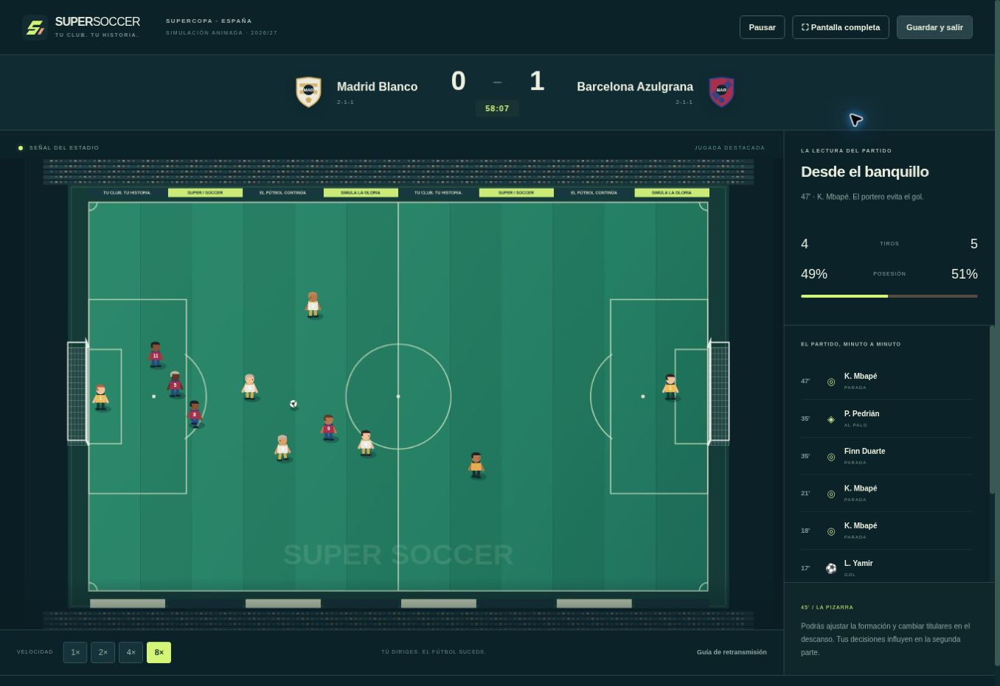

# Super Soccer

Juego original de gestión de fútbol para **PC**, en español, con partidos de **simulación animada**. El entrenador prepara la plantilla y observa la retransmisión: no controla a los futbolistas y no existe un botón para resolver instantáneamente su partido.

## Abrir el juego

Con Node.js 20 o superior, sin instalar dependencias:

```sh
npm run dev
```

Abre `http://localhost:4173`. En Windows también puedes ejecutar `INICIAR.bat`; en macOS/Linux, `./iniciar.sh`. Los lanzadores aceptan Node.js o Python 3. El servidor es local: no necesita Internet.

Para publicar el juego como web estática:

```sh
npm run check
npm test
npm run build
```

Publica el contenido de `dist/` en un servidor HTTPS. La versión compilada incluye un service worker con versión derivada del contenido y todos los recursos locales. Después de la primera carga completa, se puede volver a abrir sin conexión. En Chrome/Edge también se puede instalar como aplicación. El modo de desarrollo no usa el caché persistente, para no esconder cambios de código.



## Contenido implementado

- **188 clubes y 2.256 jugadores iniciales** de un universo ficticio inspirado en el fútbol europeo. Siete países: España, Inglaterra, Alemania, Italia, Francia, Portugal y Países Bajos.
- **31 competiciones**: catorce ligas, siete copas nacionales, siete supercopas y tres copas europeas. Primera división de 18/20 clubes y división de ascenso de ocho por país.
- Ligas de ida y vuelta, sorteos con pases directos, grupos europeos de cuatro con ida/vuelta y eliminatorias. Penaltis animados en empates de copa. Dos ascensos y descensos por país.
- Carrera multitemporada; clasificación europea según la temporada anterior; palmarés de clubes y del entrenador, historial y doce logros. Cambio de club al final de temporada sujeto a reputación.
- Modos adicionales: liga de ocho, copa de ocho y amistoso de exhibición que no modifica la carrera.
- **Simulación por mitades**: atributos, táctica, nivel rival, físico y moral determinan probabilidades; goles, asistencias, tiros, paradas, notas, tarjetas, sanciones y lesiones se registran al completar el encuentro. Los cambios del descanso intervienen en el cálculo de la segunda parte.
- Retransmisión Canvas 2D con cinco jugadores por equipo, pases, carreras, tiros, paradas, postes, goles, red, celebraciones, árbitro, tarjetas, cámara suave y confeti. Velocidad 1×/2×/4×/8×, pausa y pantalla completa.
- Alineación de un portero y cuatro jugadores de campo; cinco formaciones, incluidas adaptaciones 4-4-2 y 3-5-2, y tres planteamientos tácticos. No hay control directo ni física competitiva de futbolistas.
- **Mercado**: compra y venta con presupuesto real de cada club, agentes libres, ventanas al inicio y a mitad de temporada, contratos, primas, salarios, límites de plantilla y traspasos entre clubes de la IA.
- Filtros de ojeo por club/nombre, país, posición, edad, potencial, precio y disponibilidad económica. Fichas con siete atributos, media, potencial, edad, físico, forma, moral, valor y estadísticas de temporada y carrera.
- Cantera anual, inversión en instalaciones, foco de entrenamiento, progresión condicionada por potencial/edad/minutos, declive, retiradas y nuevas generaciones.
- Economía con entradas, TV, salarios, fichajes, instalaciones y premios de competición. Libro de movimientos.
- **Tres ranuras** independientes, autoguardado durante la retransmisión y después de cada jornada, reanudación de partidos, copia anterior, exportación/importación, comprobación de integridad y validación de datos.
- IndexedDB para carreras extensas; localStorage para ajustes y como respaldo si IndexedDB no está disponible. Si se agota el espacio, el juego lo indica y permite exportar.
- Arte vectorial, escudos, personajes y audio procedural propios. Sin cuentas, anuncios, analítica, compras ni llamadas a un backend.

## Controles del entrenador

| Acción durante la retransmisión | Tecla |
| --- | --- |
| Pausar o continuar | Espacio |
| Pausar | Esc |
| Velocidad 1× / 2× / 4× / 8× | 1 / 2 / 3 / 4 |
| Pantalla completa | F |

Las acciones también tienen botones. En el descanso, usa la pizarra para preparar el cinco de la segunda parte. Un partido guardado debe terminar antes de hacer operaciones de mercado.

## Guardado y copias

Los datos permanecen en el navegador y origen donde se crearon. Borrar los datos del navegador los elimina; exporta periódicamente desde **Partidas guardadas**. Para mover la carrera a otra máquina u origen, exporta el archivo JSON e impórtalo en una ranura. Una exportación contiene el universo completo, sin servicios externos ni credenciales. Las carreras completas pueden ocupar varios megabytes.

Cambiar la velocidad de visionado no cambia las probabilidades ni el resultado de una misma simulación. Las jugadas visuales utilizan un generador aleatorio separado del motor estadístico. La segunda mitad se calcula al salir del descanso; el resultado final se aplica una sola vez.

## Arquitectura y validación

JavaScript ESM, HTML y CSS, sin dependencias de ejecución. [Diseño](docs/DISENO.md), [arquitectura](docs/ARQUITECTURA.md) y [validación](docs/VALIDACION.md).

Las pruebas cubren calendarios, cuadros, temporadas completas, ascensos/descensos, cinco temporadas consecutivas, economía de traspasos, contratos, cantera, progreso, integridad y recuperación de guardados, coherencia de estadísticas, penaltis, reanudación en medio de una animación y resultados invariantes a FPS/velocidad.

## Alcance de esta edición

Super Soccer es una implementación propia de gestión europea, no una reproducción íntegra del código, gráficos, base de datos o catálogo mundial de World Soccer Champs. No incluye selecciones, centenares de ligas mundiales, multijugador, contenido de pago ni una base de datos oficial. Los nombres, plantillas y valoraciones son ficticios y no pretenden representar la temporada real. Los partidos son una presentación animada de un modelo estadístico, no un motor de fútbol controlable.

Código y recursos originales bajo [licencia MIT](LICENSE).
